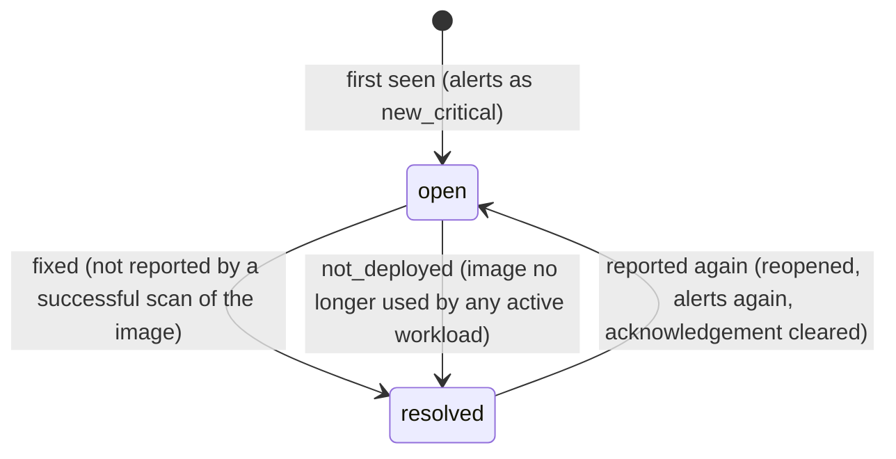

# Acknowledgements and silences

Krivy has two ways to keep known findings from alerting. Neither hides
data: acknowledged and silenced findings stay in the API, the MCP tools and
the summary. Both only affect webhook notifications. Both require a token
with the `manage` scope.

| | Acknowledgement | Silence |
|---|---|---|
| Applies to | One finding | Findings matching a finding ID, image, namespace or vulnerability |
| Suppresses `new_critical` | yes | yes |
| Suppresses `resolved` | no | yes |
| Expires | no; cleared when the finding reopens | optional `duration` / `expiresAt`; can be revoked |
| Covers future findings | no | yes, anything that matches while it is active |

## Findings lifecycle

A finding is one vulnerability in one package of one image. Its ID is a
stable hash of image key, vulnerability ID, package name, package path and
installed version, so it is the same in every scan of that image.



* Only a **successful** scan of an image can resolve its findings as
  `fixed`. A failed scan never resolves anything.
* `not_deployed` is applied after discovery, when no active workload uses the
  image any more.
* A reopened finding keeps its ID and `firstSeenAt`, gets `reopenedAt`, and
  **loses its acknowledgement**: something that came back deserves a fresh
  look.

## Which notifications fire

After every scan run, Krivy evaluates the new/reopened and resolved findings
of that run:

* **`new_critical`** includes a finding only if its severity is `CRITICAL`,
  it is **not acknowledged**, and **no active silence** covers it. (Other
  severities enabled through `trivy.severities` are tracked but never sent as
  `new_critical`.)
* **`resolved`** includes a finding only if no active silence covers it.
  Acknowledgement does not suppress resolution notices.
* `scan_failed` is not affected by acknowledgements or silences.

A brand-new finding can never be acknowledged yet, so it alerts unless a
silence already covers it.

## Acknowledgements

Acknowledging records who (`acknowledgedBy: token:<name>`), when, and an
optional reason (max 2000 characters). Acknowledging an already acknowledged
finding overwrites these fields.

REST:

```sh
curl -sS -X POST "$KRIVY/api/v1/findings/$ID/acknowledge" \
  -H "Authorization: Bearer $TOKEN" -H "Content-Type: application/json" \
  -d '{"reason":"Not exploitable: feature disabled"}'

curl -sS -X DELETE "$KRIVY/api/v1/findings/$ID/acknowledge" \
  -H "Authorization: Bearer $TOKEN"

# Unacknowledged open findings
curl -sS -G "$KRIVY/api/v1/findings" -H "Authorization: Bearer $TOKEN" \
  --data-urlencode status=open --data-urlencode acknowledged=false
```

MCP tools: `acknowledge_finding` (`id`, optional `reason`) and
`unacknowledge_finding` (`id`). For example: "Acknowledge finding 3f2a…
because the vulnerable code path is not used."

## Silences

A silence has a `kind`, a `target`, an optional `reason`, and an optional
expiry given as **either** `duration` (Go duration, e.g. `720h`) **or**
`expiresAt` (RFC 3339, must be in the future). With neither it lasts until
revoked.

| Kind | Target | Matches |
|---|---|---|
| `finding` | Finding ID (must exist) | That one finding |
| `vulnerability` | Vulnerability ID, e.g. `CVE-2024-3094` | Every finding with that ID, in every image (case-insensitive) |
| `image` | Image key `repository@sha256:…` | Findings of that exact image |
| `image` | Repository without `@`, e.g. `ghcr.io/acme/api` | Findings of **every digest** of that repository, including future ones |
| `namespace` | Namespace name | Findings whose image is used **only** in silenced namespaces (see below) |

Image keys and repositories are normalized: Docker Hub short names become
`docker.io/library/<name>`. Copy the `imageKey` or `image.repository` from a
finding to be sure. A repository silence target must not contain a tag;
`ghcr.io/acme/api:1.2` matches only an image whose key is exactly that
(an image whose running digest was unknown).

### Namespace silences and shared images

Findings belong to images, and one image can run in several namespaces. A
namespace silence covers a finding only if **every** namespace where the
image is currently deployed is covered by an active namespace silence.

Example: `busybox@sha256:abc` runs in `staging` and `production`.

* Silence `staging` only → its findings still alert (production is affected).
* Silence `staging` and `production` → they are silenced.

A namespace silence never covers a finding whose image is no longer deployed
anywhere (it has no namespaces), so `resolved` notices for undeployed images
are still sent unless another kind of silence matches.

### Creating, listing and revoking

REST:

```sh
# Accept a CVE everywhere for 30 days
curl -sS -X POST "$KRIVY/api/v1/silences" \
  -H "Authorization: Bearer $TOKEN" -H "Content-Type: application/json" \
  -d '{"kind":"vulnerability","target":"CVE-2024-3094","reason":"accepted risk","duration":"720h"}'

# Every digest of one repository, until a fixed date
curl -sS -X POST "$KRIVY/api/v1/silences" -H "Authorization: Bearer $TOKEN" \
  -d '{"kind":"image","target":"ghcr.io/acme/legacy-api","expiresAt":"2026-12-31T00:00:00Z"}'

# A sandbox namespace, no expiry
curl -sS -X POST "$KRIVY/api/v1/silences" -H "Authorization: Bearer $TOKEN" \
  -d '{"kind":"namespace","target":"sandbox","reason":"throwaway workloads"}'

curl -sS "$KRIVY/api/v1/silences" -H "Authorization: Bearer $TOKEN"           # active
curl -sS "$KRIVY/api/v1/silences?all=true" -H "Authorization: Bearer $TOKEN"  # incl. expired/revoked

curl -sS -X DELETE "$KRIVY/api/v1/silences/$SILENCE_ID" -H "Authorization: Bearer $TOKEN"
```

Create returns `201`; invalid input returns `400 bad_request`. Revoking sets
`revokedAt` / `revokedBy` and returns `200`; revoking an already revoked
silence returns it unchanged. Silences are never deleted, so the history
stays auditable.

MCP tools: `create_silence` (`kind`, `target`, `reason`, `duration` or
`expires_at`), `list_silences` (`include_inactive`) and `remove_silence`
(`id`). For example: "Silence CVE-2024-3094 for 30 days, reason: accepted
risk".

### Checking whether a finding is silenced

`GET /api/v1/findings/{id}` (MCP: `get_finding`) returns `silenced` and
`silencedBy` (the IDs of the active silences that cover it), computed with the
same rules as notifications.

## Timing

Policy is evaluated when a scan run finishes. Creating a silence or
acknowledgement does not retract notifications already sent, and revoking a
silence does not re-send anything: an existing open finding alerts again only
if it resolves and later reopens. Expired silences stop applying
automatically.
